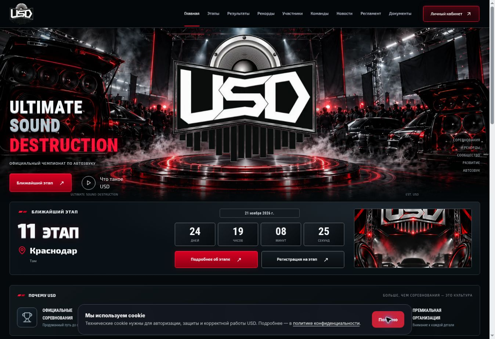
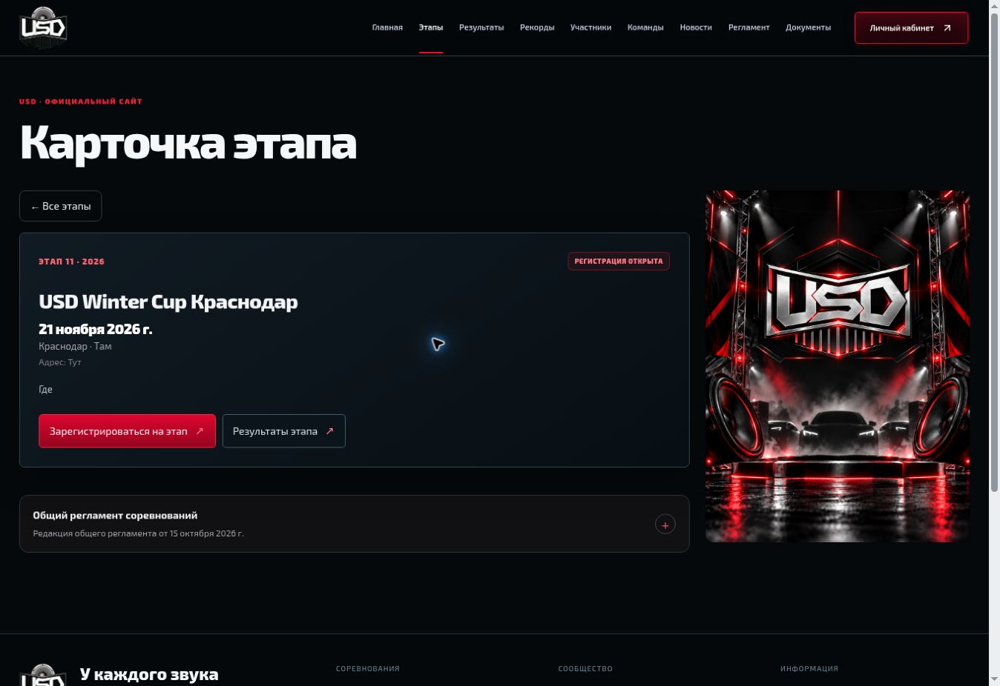
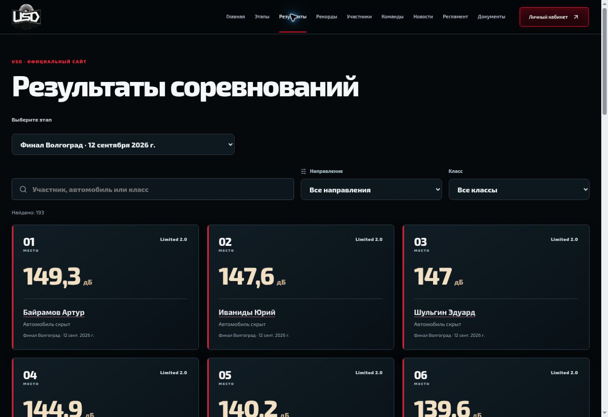
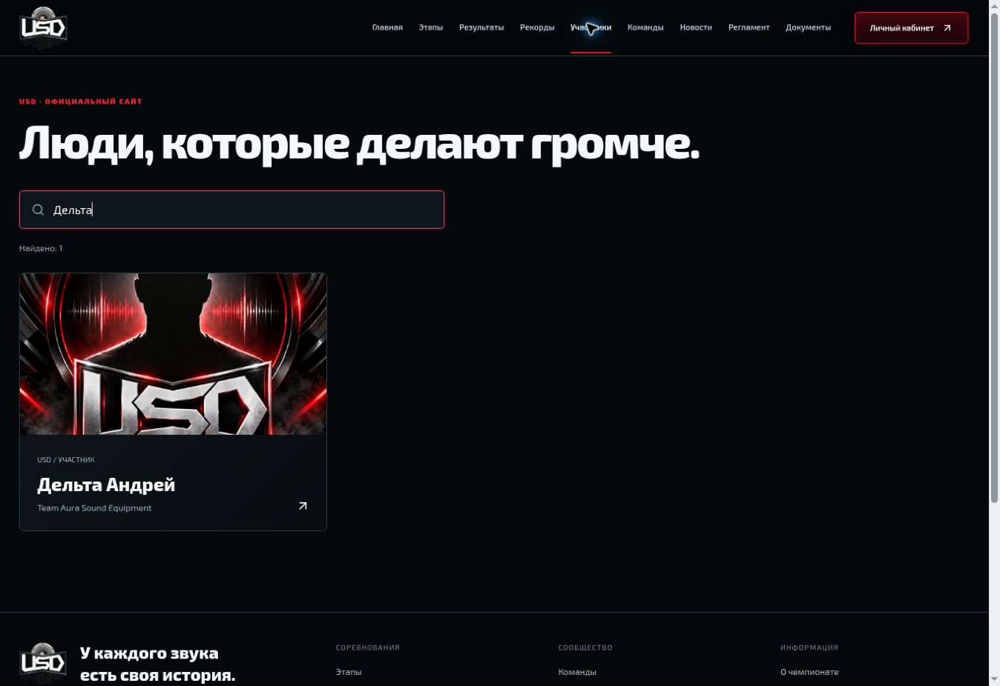
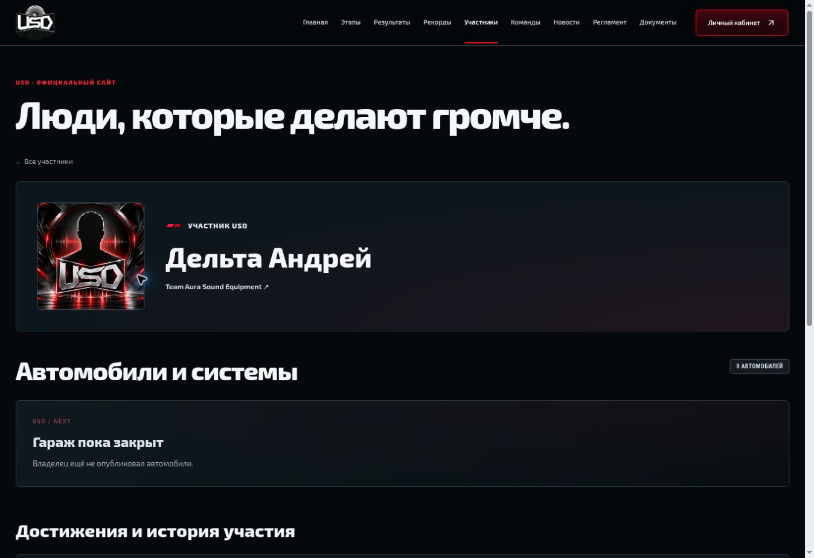
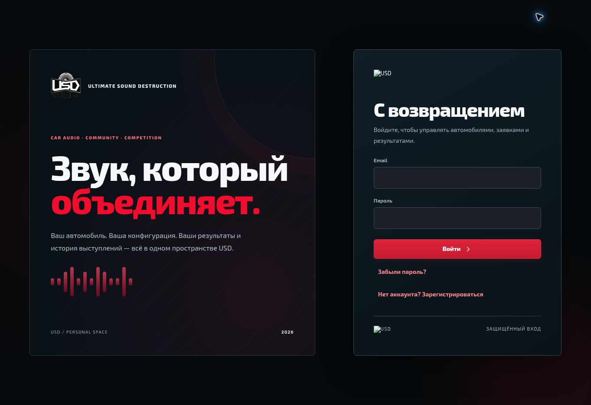
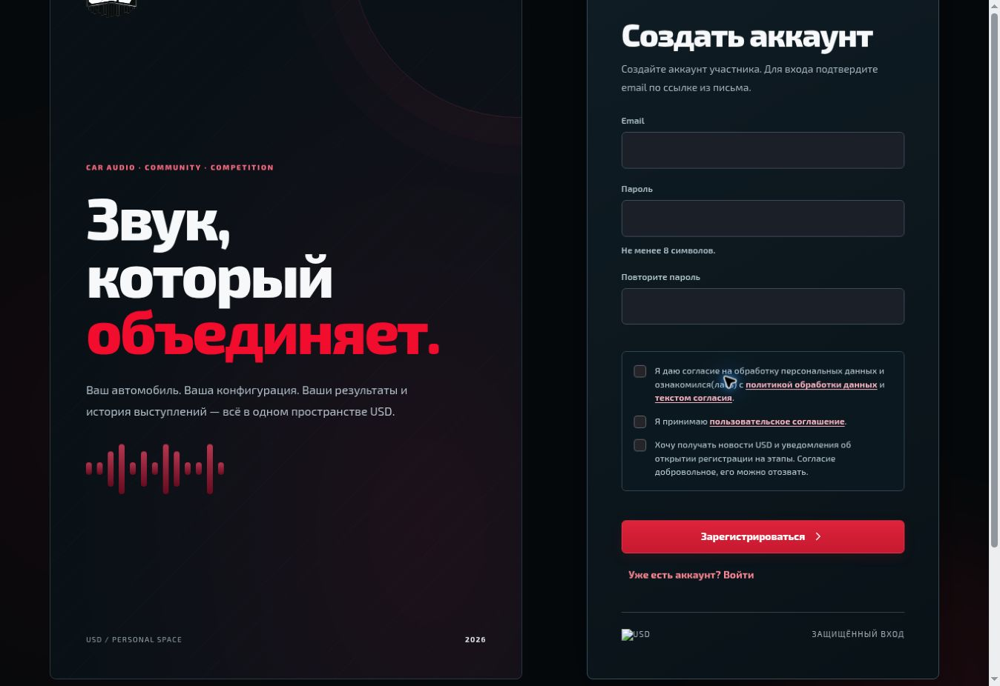
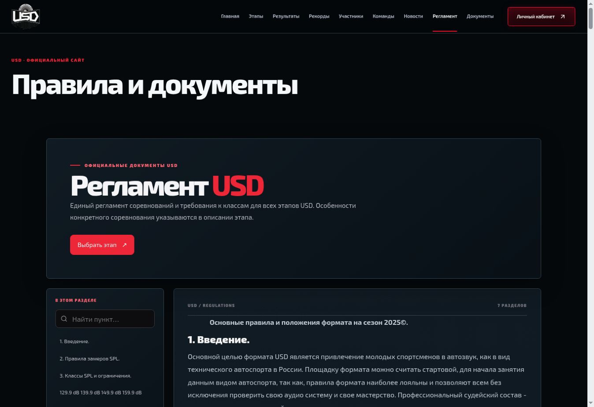
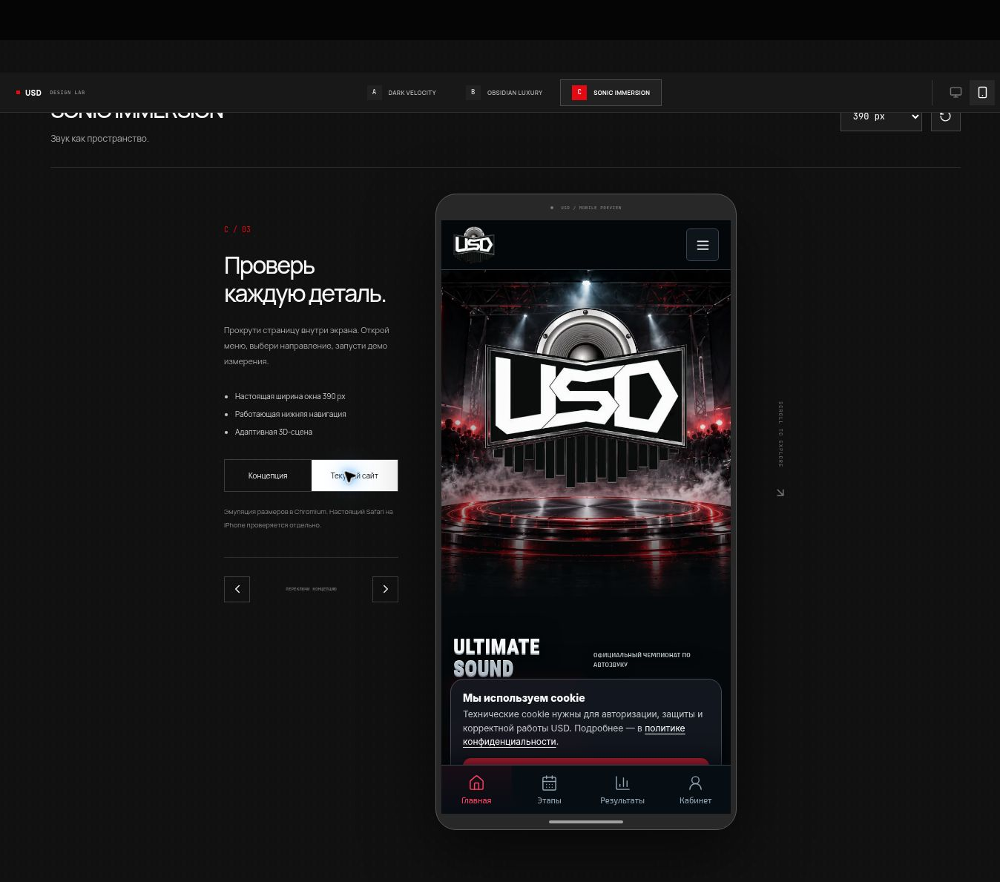

# USD — аудит исходного интерфейса и три концепции

Дата: 27 октября 2026. Исходный код: `c34876c5238f994db92837cedcfd27950b60e113`. Проверенный сайт: https://app.usd-russia.ru/.

Проведён Product Design-аудит девяти ключевых публичных экранов и состояний, изучены React-компоненты, навигация, CSS, API-клиент и существующая Three.js-сцена. Это не полный предрелизный аудит всех приватных функций и не подтверждение соответствия WCAG. Фактический вход под участником/администратором и запись данных не выполнялись.

## 1. Главная — работает, визуально перегружена

Фоновая сцена, большой знак и трёхстрочный заголовок одновременно требуют внимания. Ниже повторяются плотные панели с одинаковой рамкой и малыми подписями. Главная узнаваема, но у следующих разделов слабая самостоятельная иерархия.

В коде подготовлены шесть последних результатов, но `PremiumHome.tsx` выводит `results.slice(0,3)`. В концепциях показана требуемая структура 3 SPL + 2 BFSPL + 1 BDW SPL; рабочий компонент пока не менялся.

## 2. Карточка этапа — маршрут и регистрация доступны

Афиша сохраняет вертикальную пропорцию. Кнопка регистрации ведёт на вход с сохранённым stageId. Верхний заголовок «Карточка этапа» дублирует смысл страницы и отодвигает название события. В опубликованном описании присутствуют тестовые слова «Там», «Тут», «Где» — это проблема контента, не повод менять данные автоматически.

## 3. Результаты — фильтры и публичные профили работают

После загрузки автоматически выбран финал с результатами, показано 193 записи. Есть поиск, направление, класс и постраничное раскрытие. Карточки сохраняют единицы измерения и ссылки на участников. Очень крупный общий заголовок и несколько вертикальных отступов занимают около половины первого экрана до карточек. Золотистые цифры и синеватые поверхности расходятся с предложенной чёрно-красной палитрой.

## 4. Участники и поиск — работает

Поиск «Дельта» сужает 704 публичные записи до одного участника. Переход открывает нужный профиль. Общая иллюстрация-заглушка занимает большую часть карточки и визуально весит больше имени. Нормализация исторических профилей находится вне текущей задачи; импорт и база не менялись.

## 5. Публичный профиль — достижения доступны без входа

Профиль Дельты Андрея открыт анонимно; видны команда и история участия. Скрытые автомобили не раскрываются — это корректное соблюдение приватности. Общий заголовок страницы участников повторяется перед профилем и расходует место. В выбранном дизайне следует повысить приоритет имени и истории выступлений.

## 6. Вход — форма доступна, есть дефект изображений

Подписи Email/Пароль и восстановление доступны. На момент захвата два логотипа в правой карточке отображались как повреждённые изображения, тогда как знак слева работал. Следующий проход должен проверить CMS-источник и fallback изображения. Пароли не вводились, вход не подтверждён.

## 7. Создание аккаунта — форма и согласия доступны

Переключение формы работает. У согласий отдельные ссылки, добровольная рассылка изначально не отмечена. Длинная форма увеличивает высоту и требует прокрутки; отправка и подтверждение email не проверялись. Юридическая действительность и версии согласий этим визуальным осмотром не подтверждаются.

## 8. Регламент — опубликованный текст, поиск и оглавление доступны

После загрузки показаны семь разделов и исходный опубликованный текст. В первом экране преобладают общий заголовок и повторный вводный блок; чтение начинается низко. Нужно сохранить Word-содержимое и оглавление, сократив повторный вводный интерфейс.

## 9. Мобильная главная исходного сайта — проверена компоновка в Chromium

Использован iframe шириной 390 px с настоящим внутренним viewport. Это эмуляция размера, не Safari и не физический iPhone. Большая фоновая сцена занимает почти весь первый экран, основное сообщение и действия оказываются ниже. Cookie-уведомление и нижняя навигация конкурируют за нижнюю область. Поведение динамической панели Safari и ненулевые safe-area insets остаются непроверенными.

## Архитектура и ограничения переноса

- React 19, TypeScript, Vite, ручная маршрутизация через pathname/history и `go()`. Существующие deep links и возврат после входа сохранять.
- `App.tsx` объединяет публичные, авторизационные и часть пользовательских сценариев. `PremiumHome`, `PremiumShell`, `PublicMeasurements`, participant-компоненты и admin-модули уже отделены частично.
- Публичная тема складывается из нескольких больших глобальных CSS-слоёв. Изменение общих селекторов может задеть админку и конфигуратор; переносить выбранную концепцию с чёткой областью действия.
- В исходной сборке общий JS chunk — 1595.38 kB / gzip 462.96 kB, CSS — 673.85 kB / gzip 113.00 kB. Это ориентир для будущего разделения загрузки, не измерение Lighthouse или пользовательских Web Vitals.
- CMS управляет блоками главной, порядком/видимостью, новостями, партнёрами, изображениями и документами. Демонстрационные массивы прототипов не должны заменять CMS в приложении.
- Сохранять ADMIN/PARTICIPANT, кастомные роли/RBAC, отдельный вход в админку и личный кабинет, текущие единицы/направления и приватность публичных профилей.
- Не менять выдачу номеров, лимит классов, выбор авто/конфигурации до классов, инспекцию, исторические снимки и импорт ради дизайна. Прототипы не имеют к ним доступа.

## Три работающие концепции

| | Отличие | Главный интерактивный элемент |
| --- | --- | --- |
| A — DARK VELOCITY | Вертикальная гоночная типографика, красная энергия, динамичные разделы | Импульс и изменение интенсивности сцены |
| B — OBSIDIAN LUXURY | Сдержанная галерея, свободная композиция, тонкие линии | «Знак / Детали», в том числе с клавиатуры |
| C — SONIC IMMERSION | Акустическое поле, широкая типографика, технические подписи | Слайдер и выбор направления, корректные единицы |

Каждая содержит этапы, шесть примеров победителей, рекорды, новости, партнёров, LIVE-демо, навигацию, приглашение участника и футер. Реальных трансляций и сенсорных показаний прототип не имитирует без пометки «демо». Новые генерации не запускались; взяты два готовых ассета из истории Higgsfield. Figma и MagicPath не использовались.

## Подтверждённые проверки

| Проверка | Результат |
| --- | --- |
| Исходный frontend: `npm test` | 52 пройдено, 0 ошибок |
| Исходный frontend: `npm run build` | Пройдено |
| Прототипы: TypeScript | Пройдено |
| Прототипы: production build | Пройдено, отдельный lazy Three.js chunk |
| Прототипы: `test:sites` | 4 пройдено, 0 ошибок |
| A/B/C: viewport 360, 390, 430 px | Прокрутки документа вправо нет, нижний dock доходит до нижней границы |
| Длинные результаты и рекорды | Проверены после CSS-исправлений; Sonic на узких экранах использует одну колонку |
| Мобильное меню и Escape | Открытие и закрытие подтверждены |
| Фильтры | Предстоящие: 1 карточка; BFSPL: 2 карточки |
| Рекорды | Выбор Storm Wall показывает 512,5 м/с; BassRace не включён |
| B: переключение объекта | «Детали» и возврат к знаку подтверждены |
| C: клавиатура слайдера | End устанавливает 100%; Storm Wall переключает единицы на м/с |
| LIVE-демо | Запуск/остановка и вкладка расписания подтверждены |
| Оптимизация сцены | Вне видимой области `data-motion=paused`, на первом экране `running` |
| Оригинальный знак | Исходные байты совпадают, передняя текстура не тонируется |

В [журнале браузерной проверки](evidence/browser-qa.json) сохранены промежуточные и повторные замеры: `C` содержит найденное переполнение на 360 px, `C-fixed` — успешную повторную проверку после исправления. Это не автоматизированный CI-набор.

WebGL отключён самой облачной средой. Проверены реальная Canvas2D-анимация и статический fallback; внешний вид GPU-сцены не подтверждён. Reduced motion, save-data, обработка потери контекста и cleanup реализованы и проверены чтением кода; эмуляция этих настроек в браузере не выполнялась. Нативный Safari, iPhone с динамической адресной строкой, функциональность кабинета под учётными записями, отправка заявок/писем и Web Vitals требуют отдельного следующего прохода.

## Дальнейший порядок

1. Владелец выбирает A, B или C. Масштабного переноса до выбора нет.
2. Утвердить токены, типографику, компоненты, состояния, движение и бюджеты выбранной системы.
3. Переносить публичные маршруты небольшими изменениями поверх существующей бизнес-логики и CMS. Светлую админку и её тёмное боковое меню сохранить.
4. Проверить регистрацию, приватность, роли, конфигурации и историю в авторизованных сессиях, Safari/iPhone и на устройстве с WebGL.
5. Согласовать отдельный PR внедрения; `main` и production не менять без решения владельца.
