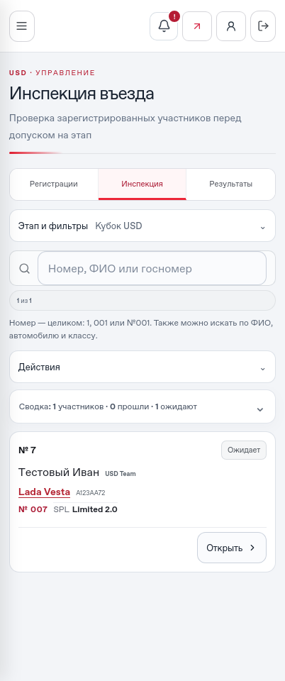
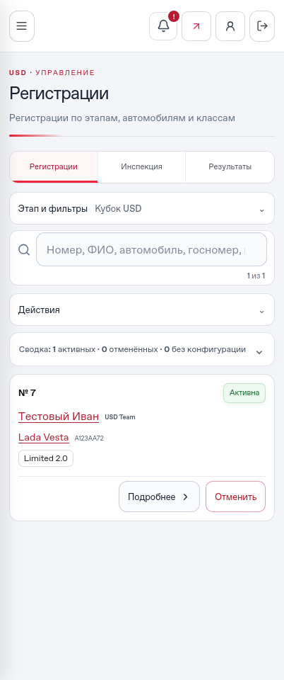
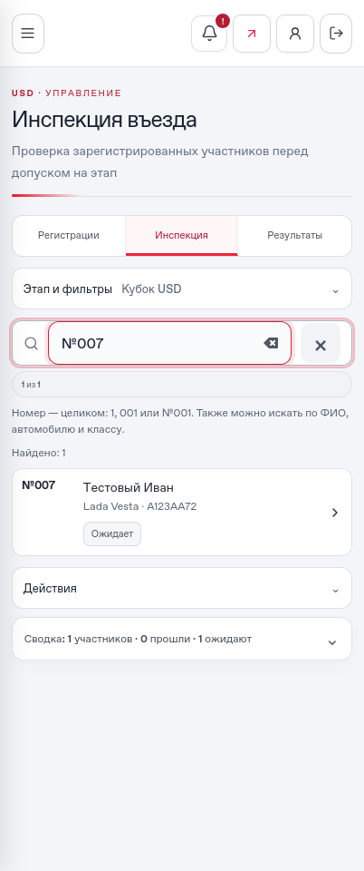
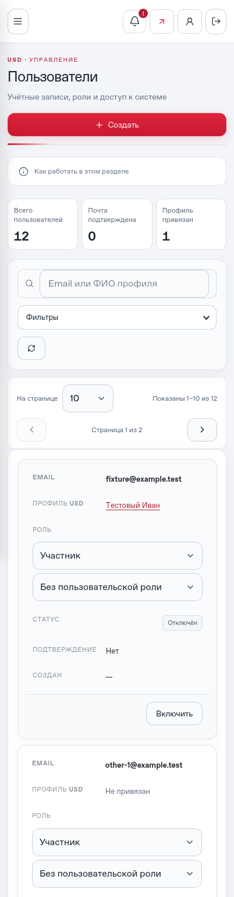

# Поиск, селекты и рабочие списки админки — 25.11.2026

Связано с [главной приёмкой #114](https://github.com/kolyagazha89/Usd-2.0/issues/114), разделами управления доступом, регистрации, инспекции и мобильного интерфейса в `docs/USD_MASTER_PLAN.md`.

## Что изменено

- Пользователи фильтруются сразу по email и ФИО **привязанного профиля**. Регистр, ё/е, повторные пробелы и порядок слов не мешают поиску. Фильтры ролей, почты и привязки работают совместно; общие счётчики сохраняют полный размер справочника. Ввод и переключение фильтров не перезагружают справочник.
- Числовой запрос в регистрациях и инспекциях сравнивается с назначенными номерами целиком: `1`, `001`, `№001`, `№ 001`, `#001`. Проверяются основной номер, дополнительные номера и номера классов. Номер 1 не находит случайные цифры в госномере, модели, классе или номере 11/101. Текстовый поиск ФИО, машины, госномера, команды и классов сохранён; поддерживается `№001 Фамилия`.
- В инспекциях поисковая выдача находится непосредственно под полем: номер, ФИО, автомобиль, госномер и статус в компактной строке. Открытие доступно с клавиатуры, записывает `registrationId` в URL; возврат сохраняет запрос. Полная таблица во время поиска не дублируется ниже.
- Убраны кнопки «Найти» из админских поисков, включая статистику и локальный QR-поиск. Запросы статистики выполняются после 300 мс паузы. Старые ответы, очистка поля, новый поиск и незавершённая загрузка прошлой карточки не возвращают устаревшую выдачу. Ошибка, повтор и отсутствие результатов показаны рядом с поиском.
- В регистрациях и инспекциях навигация оставлена тремя разделами: «Регистрации / Инспекция / Результаты». Выбор этапа и фильтры, кнопки действий и сводка свернуты. Название текущего этапа видно в закрытом блоке. Явно раскрытые блоки этапа/действий восстанавливаются при возврате из связанной карточки, сохраняя высоту и позицию списка. При отсутствии этапа выбор открыт. Экспорт, регистрация на месте, QR, массовые операции, обновление и переход к общим допускам доступны через «Действия».
- Списки регистраций и инспекций на телефонах и планшетах стали компактными: номер и статус сверху, ФИО, команда, машина и госномер, затем классы и действия. Ссылки, дополнительные номера BassRace, подтверждение отмены и ограничения завершённых этапов сохранены. Настольный табличный вид сохранён.
- Исправлен общий стиль одиночных нативных селектов: высота 48 px, вертикальные отступы 0, шрифт 16 px и отдельное место для стрелки. Вместо прежних 22 px под текст остаётся 46 px. Нативный выбор сохранён. Множественные селекты и listbox не переводятся в однострочный режим. Роли в мобильной таблице занимают всю ширину, селект пагинации имеет достаточную ширину для значения и стрелки.

Дополнительные подтверждённые неудобства: поиск статистики участника поднят перед длинными отчётами; список ролей расположен перед пустым редактором на телефоне; смена сезона не вызывает двойной запрос и не принимает запоздавший ответ другого сезона. В WebKit устранён ResizeObserver feedback при измерении cookie-панели: запись размера переносится в следующий кадр, одинаковое значение повторно не записывается.

## Проверки

Локальные проверки завершены. [Машиночитаемая сводка](assets/admin-search-2026-11-25/verification-summary.json):

- Полный набор фронтенда: **750/750**, ошибок нет.
- **138 успешных сочетаний** 46 маршрутов админки и трёх ширин: 1440, 402, 320 px. Для шести сценариев регистрации/инспекции использован успешный повтор после уточнения QA-локатора родительского `summary`; прикладной код при повторе не менялся.

- Сборка фронтенда (`npm --prefix frontend run build`).
- 25 сценариев поиска/карточек в Chromium: 1440, 1024, 402, 390, 320 px.
- 15 таких сценариев в WebKit: 402, 390, 320 px. Без ошибок JavaScript, горизонтального переполнения и обрезания строки в проверенных селектах.
- Раскрытие выбора этапа и действий клавиатурой, закрытое начальное состояние, сохранение названия этапа, компактная высота карточек и расположение первой записи в пределах первого экрана теста.
- 12 сценариев публичных страниц и кабинета при 402/320 px для проверки общих селектов.
- Отдельная браузерная проверка связанной навигации и восстановления прокрутки при 1440/390 px: после перехода из регистрации в автомобиль и обратно сохранены этап, карточка и позиция списка.
- Отдельные runtime-тесты раскрытия/восстановления блоков, изоляции рабочих разделов, поиска ФИО, подтверждения прав, задержки поиска, запоздавших ответов/ошибок, очистки, повторного поиска, смены сезона и отложенного измерения cookie-панели.

Браузерные проверки выполнялись на локальной production-сборке с синтетическими данными и перехватом API. Реальные записи, база и внешние операции не изменялись. Полный штатный прогон воспроизводится через `scripts/candidate-browser-qa.mjs`; проверки поиска и размеров селектов находятся в `scripts/admin-search-browser-qa.mjs`.

Для локального WebKit временно установлены Playwright и системные библиотеки вне репозитория. Зависимости загружены в каталог браузера, запуск и рендеринг проверены; проверка глобального наличия библиотек Playwright отключалась, поскольку библиотеки доступны в локальном каталоге инструмента. Это не отключает проверки приложения.

Состояния релиза разделены: локальный кандидат; слияние, exact-SHA CI, развёртывание и живая приёмка фиксируются отдельно в #114. Физический iPhone 17 Pro и live-развёртывание этим локальным прогоном не подтверждены. Миграций и изменений API/RBAC нет.

## Скриншоты WebKit, 402 px

