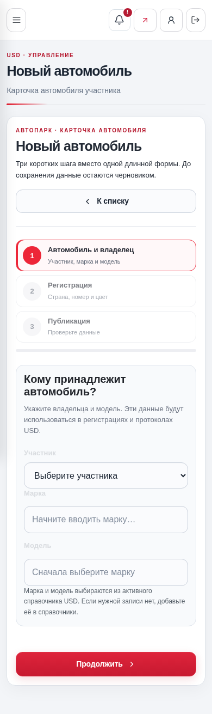
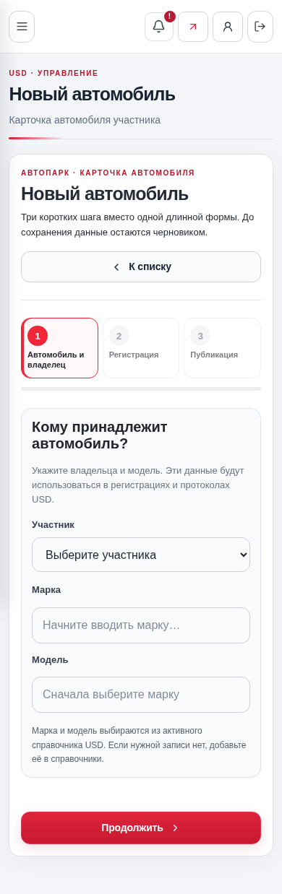
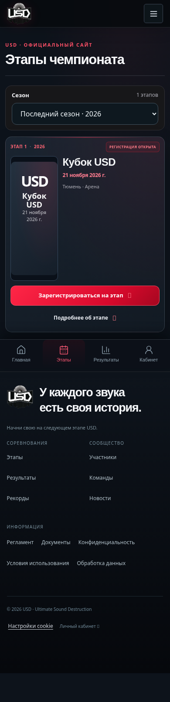
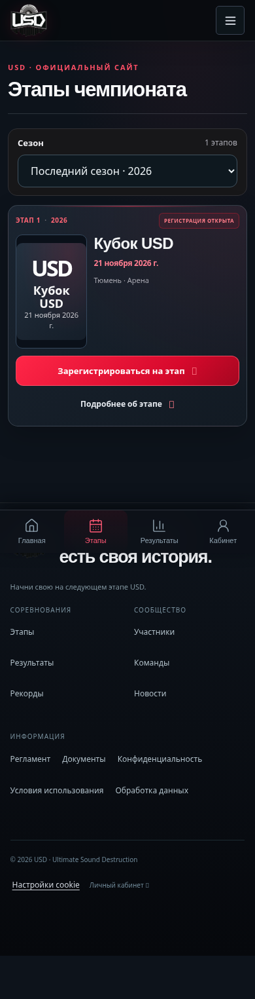
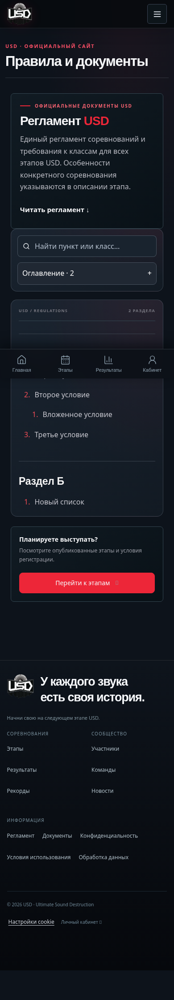
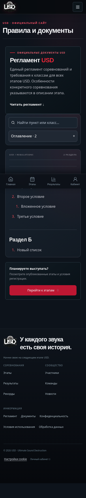

# USD: проверка интерфейса и отступов — 25.11.2026

Проверена локальная production-сборка на основе `fc7391d5edb6dfc46ddd4533ef2ca20174999c39`.
Связано с #114: мобильная админка, кабинет, конфигурация автомобиля и публичные страницы.

## Охват и результат

Первый проход: **128 вариантов маршрутов, 338 сочетаний маршрута/роли/ширины**.
На 1440 и 390 px — по 128 вариантов, на 1024 и 320 px — по 41 ключевому варианту.
Роли: публичный посетитель, участник, новый участник и ADMIN. Фикстуры синтетические;
все обращения к удалённому API перехватывались, рабочая БД не использовалась.

1. Публичные страницы: главная, этапы, результаты, рекорды, участники, автомобили,
   команды, новости, партнёры, регламент, документы, контакты и вход. Геометрия
   исправна в проверенной матрице; найдены скачок фото на главной, высокая заглушка
   афиши и слабый контраст кнопки регламента.
2. Кабинет: профиль и его разделы, гараж, конфигуратор, заявка, QR и подтверждение.
   В проверенных сценариях не обнаружено горизонтального переполнения и ошибок runtime.
   Проверены также отсутствие этапа и временная недоступность API.
3. Админка: списки, создание автомобиля/этапа, регистрация, инспекция, судейство,
   отчёты, справочники, пользователи, роли, настройки, почта и ассистент.
   Найдены бледные вложенные подписи и отсутствующие интервалы в форме автомобиля.
4. Мобильная проверка: 390 и 320 px, включая навигацию, ошибки, пустые состояния
   и редактирование оборудования. Исправлен слишком высокий блок шагов автомобиля.
5. После правок: **28 целевых сценариев на четырёх ширинах прошли**;
   **12 экранов axe WCAG A/AA — 0 обнаруженных нарушений**. Полный набор
   frontend-тестов — **743 passed**, production build и `git diff --check` успешны.

В исходном прогоне 334 сценария прошли, четыре проверки главной ожидали
незагруженное ленивое фото новости. Это воспроизвело сдвиг блока на реальном
Chromium: высота изображения до прокрутки была 0, после — более 500 px.
После ранней загрузки трёх карточек главной эти четыре сценария проходят.
Остальные изображения по умолчанию продолжают загружаться отложенно.

## Подтверждённые недочёты и исправления

| Приоритет | Где | Было и влияние | Исправление |
|---|---|---|---|
| P1 | Вложенные подписи форм админки | Светлый `#d9dce0` на `#f8fafc`, контраст 1.31:1: название поля почти не видно | Общий светлый слой админки задаёт `#374151`, контраст 9.85:1 на этой поверхности |
| P1 | Регламент: «Перейти к этапам» | Контраст 3.9:1 при обычном тексте 14 px, ниже 4.5:1 | Более тёмный фирменный красный `#bd1732`, контраст 5.79:1 |
| P2 | Форма автомобиля | Между селектором владельца и следующей группой 0 px | Панель имеет сетку с интервалом 16 px; убраны прежние суммирующиеся отступы заголовков/сводки |
| P2 | Шаги автомобиля на телефоне | Вертикальный список шагов занимает 188 px до полей | Все три шага видны в одном ряду; 84 px на 390 px и 97 px на 320 px |
| P2 | Этап без афиши на телефоне | Заглушка наследует минимум 260 px, фактическая высота 286 px; справа пустое место | Заглушка получает естественную высоту и компактные отступы; настоящие загруженные афиши не меняются |
| P2 | Фото новостей главной | Блок растёт с 1 до 536 px при прокрутке на 390 px | До трёх фотографий главной загружаются заранее; в повторном сценарии высота 536 px до и после прокрутки |

### Измерения на 390 px

| Показатель | До | После |
|---|---:|---:|
| Отступ между владельцем и следующей группой | 0 px | 16 px |
| Высота навигации шагов автомобиля | 188.28 px | 83.50 px |
| Верх первой подписи поля автомобиля | 823.08 px | 718.30 px |
| Высота карточки этапа без афиши | 449.25 px | 338.02 px |
| Высота заглушки афиши | 286 px | 174.77 px |
| Высота блока фото новости до/после прокрутки | 1 → 536.19 px | 536.19 → 536.19 px |

### Скриншоты из этого прохода

| Экран | До | После |
|---|---|---|
| Форма автомобиля |  |  |
| Карточка этапа |  |  |
| Регламент |  |  |

## Что работает и что не следует считать дефектом

- В исходной матрице не было горизонтального переполнения документа;
  проверенные поля ввода имели размер текста не меньше 16 px.
- Публичная часть и кабинет сохранили тёмную тему, админка — светлую.
- Единственный автоматический сигнал об обрезанной подписи — «Контекст этапа»
  у ассистента на телефоне. Проверка CSS подтвердила намеренное скрытие для
  скринридеров (`clip-path:inset(50%)`), это не потерянная видимая подпись.
- Пустые результаты/недоступные документы в фикстурах не выдаются за поломку production.
- Фиксированная нижняя панель, попадающая в середину полного скриншота длинной
  страницы, сама по себе не означает перекрытие при реальной прокрутке.

## Ограничения

Это широкая проверка маршрутов и выборочная визуальная проверка состояний,
а не гарантия всех возможных данных/комбинаций прав и полной WCAG-совместимости.
Физические iPhone/Safari, реальная экранная клавиатура, normal-motion WebGL,
медленная сеть, реальные личные аккаунты и операции записи в production не проверялись.
Раннее получение фото главной уменьшает наблюдавшийся сдвиг при прокрутке, но
не заменяет хранение размеров изображений для строгой гарантии CLS на любой сети.

Полный локальный набор скриншотов и JSON находится в
`/workspace/interface-audit-2026-11-25/`; в репозиторий включены только шесть
выбранных кадров без реальных персональных данных.

Статус: код подготовлен в отдельной ветке; CI PR, слияние, развёртывание и
живая приёмка учитываются отдельно. Замечания этого прохода не закрывают весь #114.

## Матрица маршрутов первого прохода

`OK` — технический сценарий прошёл, это не оценка идеальности дизайна.
`Фото*` — ожидание ленивого фото главной; повторная проверка после правки успешна.
`—` — данный вариант маршрута на этой ширине не запускался.

| Роль | Маршрут/состояние | 1440 | 1024 | 390 | 320 |
|---|---|---|---|---|---|
| ADMIN | `/admin` | OK | OK | OK | OK |
| ADMIN | `/admin/assistant` | OK | — | OK | — |
| ADMIN | `/admin/audit` | OK | — | OK | — |
| ADMIN | `/admin/cars` | OK | — | OK | — |
| ADMIN | `/admin/cars/configurations?carId=car1` | OK | — | OK | — |
| ADMIN | `/admin/cars/new` | OK | OK | OK | OK |
| ADMIN | `/admin/classes` | OK | — | OK | — |
| ADMIN | `/admin/components` | OK | OK | OK | OK |
| ADMIN | `/admin/data-quality` | OK | OK | OK | OK |
| ADMIN | `/admin/disqualifications` | OK | — | OK | — |
| ADMIN | `/admin/email-templates` | OK | — | OK | — |
| ADMIN | `/admin/email-testing` | OK | — | OK | — |
| ADMIN | `/admin/event-day?stageId=stage1` | OK | OK | OK | OK |
| ADMIN | `/admin/historical-results` | OK | — | OK | — |
| ADMIN | `/admin/inspections` | OK | OK | OK | OK |
| ADMIN | `/admin/inspections?stageId=stage1&registrationId=reg1` | OK | — | OK | — |
| ADMIN | `/admin/legal-documents` | OK | — | OK | — |
| ADMIN | `/admin/media` | OK | — | OK | — |
| ADMIN | `/admin/news` | OK | — | OK | — |
| ADMIN | `/admin/notifications` | OK | OK | OK | OK |
| ADMIN | `/admin/participants` | OK | — | OK | — |
| ADMIN | `/admin/partners` | OK | — | OK | — |
| ADMIN | `/admin/profile-links` | OK | — | OK | — |
| ADMIN | `/admin/records` | OK | — | OK | — |
| ADMIN | `/admin/registrations` | OK | OK | OK | OK |
| ADMIN | `/admin/results` | OK | — | OK | — |
| ADMIN | `/admin/results?stageId=stage1` | OK | OK | OK | OK |
| ADMIN | `/admin/results?stageId=stage1&registrationId=reg1&entry=1` | OK | — | OK | — |
| ADMIN | `/admin/roles` | OK | — | OK | — |
| ADMIN | `/admin/rules` | OK | — | OK | — |
| ADMIN | `/admin/season-report` | OK | OK | OK | OK |
| ADMIN | `/admin/seasons` | OK | — | OK | — |
| ADMIN | `/admin/site-settings` | OK | OK | OK | OK |
| ADMIN | `/admin/site-settings?section=homepage&step=blocks` | OK | — | OK | — |
| ADMIN | `/admin/site-settings?section=homepage&step=copy` | OK | — | OK | — |
| ADMIN | `/admin/site-settings?section=homepage&step=hero` | OK | OK | OK | OK |
| ADMIN | `/admin/site-settings?section=legal` | OK | — | OK | — |
| ADMIN | `/admin/stage-report?stageId=stage1` | OK | OK | OK | OK |
| ADMIN | `/admin/stages` | OK | — | OK | — |
| ADMIN | `/admin/stages/new` | OK | — | OK | — |
| ADMIN | `/admin/statistics` | OK | — | OK | — |
| ADMIN | `/admin/teams` | OK | — | OK | — |
| ADMIN | `/admin/users` | OK | — | OK | — |
| ADMIN | `/admin/vehicle-catalog` | OK | OK | OK | OK |
| ADMIN | `/admin/vibration` | OK | — | OK | — |
| ONBOARDING | `/participant` | OK | OK | OK | OK |
| PARTICIPANT | `/` | OK | — | OK | — |
| PARTICIPANT | `/about` | OK | — | OK | — |
| PARTICIPANT | `/cars` | OK | OK | OK | OK |
| PARTICIPANT | `/cars/car1` | OK | OK | OK | OK |
| PARTICIPANT | `/cars/missing` | OK | — | OK | — |
| PARTICIPANT | `/consent` | OK | — | OK | — |
| PARTICIPANT | `/contacts` | OK | — | OK | — |
| PARTICIPANT | `/documents` | OK | — | OK | — |
| PARTICIPANT | `/news` | OK | — | OK | — |
| PARTICIPANT | `/news/news-image-fixture` | OK | — | OK | — |
| PARTICIPANT | `/offline-event` | OK | — | OK | — |
| PARTICIPANT | `/participant` | OK | OK | OK | OK |
| PARTICIPANT | `/participant/car/new` | OK | — | OK | — |
| PARTICIPANT | `/participant/car?carId=car1` | OK | — | OK | — |
| PARTICIPANT | `/participant/configurations?carId=car1` | OK | — | OK | — |
| PARTICIPANT | `/participant/configurations?carId=car1&edit=config1` | OK | OK | OK | OK |
| PARTICIPANT | `/participant/configurations?carId=car1&view=config1` | OK | — | OK | — |
| PARTICIPANT | `/participant/register` | OK | — | OK | — |
| PARTICIPANT | `/participant/register?stageId=missing` | OK | — | OK | — |
| PARTICIPANT | `/participant/register?stageId=outage` | OK | — | OK | — |
| PARTICIPANT | `/participant/register?stageId=stage1` | OK | OK | OK | OK |
| PARTICIPANT | `/participant/registration-success?registrationId=reg1` | OK | OK | OK | OK |
| PARTICIPANT | `/participant/registration?registrationId=reg1` | OK | — | OK | — |
| PARTICIPANT | `/participant?tab=cars` | OK | — | OK | — |
| PARTICIPANT | `/participant?tab=profile` | OK | OK | OK | OK |
| PARTICIPANT | `/participant?tab=profile&section=consents` | OK | — | OK | — |
| PARTICIPANT | `/participant?tab=profile&section=notifications` | OK | — | OK | — |
| PARTICIPANT | `/participant?tab=profile&section=security` | OK | — | OK | — |
| PARTICIPANT | `/participant?tab=profile&section=sessions` | OK | — | OK | — |
| PARTICIPANT | `/participant?tab=registrations` | OK | — | OK | — |
| PARTICIPANT | `/participants` | OK | OK | OK | OK |
| PARTICIPANT | `/participants/missing` | OK | OK | OK | OK |
| PARTICIPANT | `/participants/offline` | OK | OK | OK | OK |
| PARTICIPANT | `/participants/p1` | OK | OK | OK | OK |
| PARTICIPANT | `/partners` | OK | — | OK | — |
| PARTICIPANT | `/privacy` | OK | — | OK | — |
| PARTICIPANT | `/records` | OK | — | OK | — |
| PARTICIPANT | `/results?stageId=stage1` | OK | OK | OK | OK |
| PARTICIPANT | `/rules` | OK | — | OK | — |
| PARTICIPANT | `/stages` | OK | OK | OK | OK |
| PARTICIPANT | `/stages/%E0%A4%A` | OK | — | OK | — |
| PARTICIPANT | `/stages/missing` | OK | — | OK | — |
| PARTICIPANT | `/stages/offline` | OK | OK | OK | OK |
| PARTICIPANT | `/stages/stage1` | OK | — | OK | — |
| PARTICIPANT | `/teams` | OK | — | OK | — |
| PARTICIPANT | `/teams/USD%20Team` | OK | OK | OK | OK |
| PARTICIPANT | `/terms` | OK | — | OK | — |
| PARTICIPANT | `/unknown-page` | OK | — | OK | — |
| PUBLIC | `/` | Фото* | Фото* | Фото* | Фото* |
| PUBLIC | `/about` | OK | — | OK | — |
| PUBLIC | `/cars` | OK | — | OK | — |
| PUBLIC | `/cars/car1` | OK | — | OK | — |
| PUBLIC | `/cars/missing` | OK | — | OK | — |
| PUBLIC | `/confirm-email-change` | OK | — | OK | — |
| PUBLIC | `/consent` | OK | OK | OK | OK |
| PUBLIC | `/contacts` | OK | — | OK | — |
| PUBLIC | `/documents` | OK | — | OK | — |
| PUBLIC | `/login` | OK | OK | OK | OK |
| PUBLIC | `/login?next=%2Fparticipant%2Fregister%3FstageId%3Dstage1` | OK | OK | OK | OK |
| PUBLIC | `/news` | OK | — | OK | — |
| PUBLIC | `/news/news-image-fixture` | OK | — | OK | — |
| PUBLIC | `/offline-event` | OK | — | OK | — |
| PUBLIC | `/participant/register?stageId=stage1` | OK | OK | OK | OK |
| PUBLIC | `/participants` | OK | — | OK | — |
| PUBLIC | `/participants/missing` | OK | OK | OK | OK |
| PUBLIC | `/participants/offline` | OK | OK | OK | OK |
| PUBLIC | `/participants/p1` | OK | — | OK | — |
| PUBLIC | `/partners` | OK | — | OK | — |
| PUBLIC | `/privacy` | OK | — | OK | — |
| PUBLIC | `/records` | OK | — | OK | — |
| PUBLIC | `/reset-password` | OK | — | OK | — |
| PUBLIC | `/results?stageId=stage1` | OK | OK | OK | OK |
| PUBLIC | `/rules` | OK | — | OK | — |
| PUBLIC | `/stages` | OK | OK | OK | OK |
| PUBLIC | `/stages/%E0%A4%A` | OK | OK | OK | OK |
| PUBLIC | `/stages/missing` | OK | — | OK | — |
| PUBLIC | `/stages/offline` | OK | OK | OK | OK |
| PUBLIC | `/stages/stage1` | OK | — | OK | — |
| PUBLIC | `/teams` | OK | — | OK | — |
| PUBLIC | `/teams/USD%20Team` | OK | — | OK | — |
| PUBLIC | `/terms` | OK | — | OK | — |
| PUBLIC | `/unknown-page` | OK | — | OK | — |
