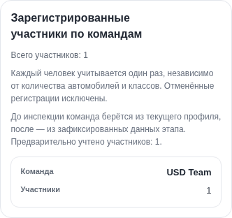

# Зарегистрированные люди по командам на этапе

Связано с #114: отчёты по этапам и статистика команд.

В «Статистика → Отчёт после этапа» добавлен блок
«Зарегистрированные участники по командам». Он доступен и в печатной сводке/PDF.
Это количество зарегистрированных людей, не число машин, классов, номеров,
результатов или медалей. Медальная сводка остаётся отдельной.

## Правила подсчёта

- Только ACTIVE-регистрации выбранного этапа. Один participantId учитывается
  ровно один раз, в том числе при нескольких автомобилях/номерах/классах.
- Используется самая ранняя зафиксированная принадлежность человека на этапе,
  одинаково для всех его автомобилей. Явно сохранённое отсутствие команды
  означает «Без команды»; отсутствие исторических сведений — «Нет данных о команде».
- До инспекции на текущем/будущем PUBLISHED-этапе разрешён предварительный
  подсчёт по одобренному активному членству (или старому полю профиля, если
  членства нет). Предварительные сведения обозначены в интерфейсе.
- Текущие профили не восстанавливают команды завершённых/прошлых/опубликованных
  этапов, импортированных регистраций и этапов с отменённой публикацией результатов.
  Неизвестные исторические данные не подменяются сегодняшним составом.
- Ключ команды с сохранённым ID переживает переименование; разные ID
  не объединяются только из-за одинаковых названий. Старые имена без ID
  сравниваются после нормализации регистра и пробелов.
- Сортировка: по убыванию числа людей, при равенстве — по названию.

ADMIN API `/statistics/stages/:stageId` получает дополнительное поле
`stats.teamParticipation` с общим количеством уникальных людей, количеством
предварительно учтённых людей и строками команд. Старый API без поля
показывается как «данные пока недоступны», а не как нулевое участие.
Схема БД, публичные API, результаты и регистрации не изменяются.

## Проверки

- Backend: 166 suite passed, 1 skipped; 1534 tests passed, 7 skipped.
  Полный набор запускается после официального `prisma generate` через build;
  генерация не подключается к БД. Первый запуск до генерации обнаружил
  устаревшие tracked Prisma enums; после генерации полный набор прошёл.
- Frontend: 744 tests passed, включая модель отчёта и отсутствие новых полей
  у старого API.
- Backend и frontend build успешны. Backend lint завершился без ошибок;
  существующие предупреждения в соседних модулях не менялись.
- Browser QA на 1440, 1024, 390 и 320 px: четыре сценария отчёта прошли,
  новый блок не выходит за экран; печатный режим сохраняет настоящую таблицу.
- Проверены дедупликация, отмена, команды без подиумов, состав до инспекции,
  историческая принадлежность, переименования, одинаковые названия разных команд,
  отсутствие команды и запрет пересчёта после отмены публикации.

В тестах и скриншоте использованы синтетические данные. Реальная БД,
production-записи, физический iPhone и фактический PDF-принтер не использовались.
Статусы CI PR, слияния, развёртывания и живой приёмки учитываются отдельно.
